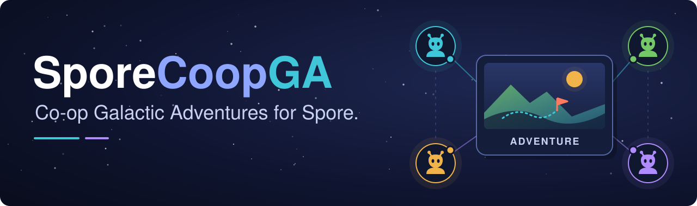

<p align="center">
  
</p>

<p align="center">
  <a href="https://github.com/jwhans0n/SporeCoopGA/actions/workflows/build.yml?query=branch%3Amain"></a>
  
  <a href="LICENSE"></a>
</p>

# SporeCoopGA

**Play Spore: Galactic Adventures together.** Form a party, choose your captains,
and enter the same adventure from Sporepedia.

This fork focuses on co-op adventure play, with **shared live adventure editing**
next on the roadmap and collaborative editing in other Spore editors later.
Shared editing is planned and is not available in the current preview.

SporeCoopGA builds on [SporeCoop](https://github.com/WoodyWizard/SporeCoop) by
[WoodyWizard](https://github.com/WoodyWizard). The current build is
**`0.7.3.5-ga-preview.12`**, an experimental preview using protocol **15**.

## Contents

- [Current GA features](#current-ga-features)
- [Installation](#installation)
- [Playing together](#playing-together)
- [Compatibility and status](#compatibility-and-status)
- [Roadmap](#roadmap)
- [Development](#development)
- [Credits](#credits)

## Current GA features

- **Shared Sporepedia adventures.** Form a party of up to four players, then use
  an adventure's normal Play button. Supported missing adventure and captain
  resources transfer during preparation; stock resources and cached transfers are reused.
- **Your saved captain.** Select an existing captain or use the native creation,
  naming and saving screens. Adventures with an authored captain keep that restriction.
- **A shared adventure lobby.** Review the adventure card, captain portraits,
  transfer progress and settings. Everyone, including the host, explicitly presses Ready.
- **Shared objectives and scenes.** Host-authoritative progress keeps the party
  in the same act. Beam-down Continue waits for everyone; conversation pages
  advance independently, with a group confirmation before leaving. Confirmations
  appear in the native bottom black bar beside the check mark.
- **Synchronized interactions.** Shared keys and gates, explosives, crates,
  collector-only power upgrades and independent teleporters follow the adventure
  rules. The host controls authoritative damage and shared object state.
- **Shared handheld items.** Give items to NPCs through native interactions,
  see their held tools, and throw eligible items between captains. Timed bombs
  keep their running fuse when caught; contact grenades retain impact behavior.
- **Party pause.** Opening Esc stops your input; the shared adventure pauses
  when every connected participant is paused and resumes when anyone returns.
- **Native actor movement.** Client creatures and vehicles follow host waypoints
  between updates using native locomotion. Hard corrections handle initial
  binding, large divergence, stuck movement and confirmed stationary disagreement;
  the host retains AI, combat and objective authority.
- **Enemy targeting for guest captains.** Authored player-team attack targets
  can recognize eligible guests. Native sensing, hostility and NPC target
  selection remain in control; existing authored nonparty targets are preserved.
- **Downed and revival feedback.** Downed captains stay in place while their
  normal visuals update. A six-metre revive ring, progress bar and timer show
  teammates where to stand and how long to remain nearby.
- **Shared results and recovery.** A host-confirmed win or loss stops gameplay for
  the party. Host Done returns everyone to the menu; guest Done accepts results
  locally. Replay requires the host to choose Replay and everyone to apply and
  accept their results, then opens
  the shared lobby with saved captains and everyone unready. Cancelling preparation
  restores the native menus for retry.
- **Adventure performance work.** The preview retains the actor-memory validation
  FPS fix. Unchanged static transforms stop recurring after their initial baseline;
  moving actors continue receiving spatial updates.

See the [GA guide](docs/GALACTIC-ADVENTURES.md) for interaction rules, settings,
asset transfer, Replay and current limits.

## Installation

Every player needs **Spore with Galactic Adventures**, the supported GOG executable
described below, and **the same SporeCoopGA build**.

**There is no published GitHub release yet.** Install the current development preview
from this fork:

1. Open the [build workflow for `main`](https://github.com/jwhans0n/SporeCoopGA/actions/workflows/build.yml?query=branch%3Amain),
   select the latest successful run for `main`, and download its **`sporecoop-zip`**
   artifact. GitHub requires you to sign in to download workflow artifacts.
2. Extract the downloaded artifact archive. Keep **`SporeCoopSetup.exe`** beside
   its matching **`SporeCoop-<version>.pack`** file.
3. Close Spore, run that setup, select the **SPORE** folder containing
   `SporebinEP1`, and install.
4. Start Galactic Adventures (`SporebinEP1\SporeApp.exe`). The galaxy menu should
   contain **Co-op**.

The artifact also contains a preview zip with `install.bat` for manual installation.
Full setup, game-build checks, networking and troubleshooting are in the
[installation guide](docs/INSTALL.md). Use this fork's packages for GA support.

**Updates use published [GitHub Releases](https://github.com/jwhans0n/SporeCoopGA/releases),
not branches or Actions artifacts.** The current updater skips prereleases and does
not order preview suffixes. Install GA preview updates manually using their matching
package; merging new source into `main` does not update an installed game.

## Playing together

1. From the galaxy menu, the host opens **Co-op** and hosts a party. Other players
   join before the adventure begins. **F9** opens party and chat controls.
2. The host chooses the difficulty in **Adventure settings**.
3. The host opens the adventure in **Sporepedia** and presses **Play**.
4. Each player selects a captain, or creates, names and saves a new one using the
   native captain screens.
5. Review the adventure and captain cards. Wait for preparation to finish, then
   **every player presses Ready**, including the host.
6. After beam-down, **everyone presses Continue**. Gameplay and adventure clocks
   wait for the whole party.

Changing a captain clears readiness. Cancelling preparation keeps successfully
saved captains and returns the party to the menu. After a win or loss, gameplay
stays stopped. **Host Done returns the whole party to the menu.** Guest Done
accepts that player's results locally. Any player can request Replay; the host
must choose Replay and everyone must apply and accept their results before the
shared lobby opens. Everyone presses Ready again. Finish any mandatory native
captain reward selection before a party exit completes, so captain saving is
preserved. The party stays connected through menu recovery.

For LAN discovery, internet connections and port forwarding, see
[networking in the installation guide](docs/INSTALL.md#7-playing-over-the-internet).

## Compatibility and status

Native co-op adventures currently require the **exact GOG 2024 executable**:
`SporebinEP1\SporeApp.exe`, 24,895,536 bytes, with SHA-256:

```text
dc04aee5a3debc3f1ad4c1a937460e99a29b9bd3bc285008be83615dd5e59a37
```

- **Verified GA configuration:** Windows with that exact executable. Steam and
  other executables are not enabled for the native GA adapter; Linux GA play
  remains unvalidated.
- **Matching clients:** all participants need this fork build and protocol 15.
  Earlier GA previews also require an update before joining.
  Upstream SporeCoop 0.7.0-0.7.2.1 clients use a different protocol and cannot join.
- **Entry and joining:** adventures start from Sporepedia. Space-stage adventure
  entry is outside this preview. Late joins and reconnects wait for the next attempt.
- **Validation scope:** preview 12's shared-result, menu return and Replay
  acceptance is recorded separately in its
  [validation report](docs/validation-ga-preview.12.md). Earlier preview 11 passes
  targeted two-player Mine checks for
  native guest/host targeting, natural damage and target switching. Broader
  adventure compatibility remains unproven; see its
  [validation report](docs/validation-ga-preview.11.md) for exact evidence.
  Preview 10 repairs frozen vehicle models and verifies continuous
  native creature walking in two-player Mine checks. Position tracking remains
  approximate; its [validation report](docs/validation-ga-preview.10.md) records
  material residual lag and the exact scope. The [preview 9 report](docs/validation-ga-preview.9.md) retains its
  NPC presentation, unanimous pause and six-metre revival checks. The
  [preview 8 report](docs/validation-ga-preview.8.md) retains the earlier music,
  item, downed, lighting, conversation/Replay and four-player evidence.
  Ordinary guest click/key combat input remains unverified; controlled damage
  checks do not establish that input path.
  A complete adventure playthrough campaign remains outstanding.

The preview does not establish compatibility with every custom adventure, palette
or objective. Read the [preview 12 validation report](docs/validation-ga-preview.12.md)
and [historical integration report](docs/integration-ga-upstream-0.7.2.1.md)
for exact evidence and limits, and the [known issues](docs/known-issues.md) for
recorded problems.

## Roadmap

1. **Strengthen co-op adventure play (ongoing).** Broader adventure compatibility,
   complete playthrough coverage, and extended multiplayer testing.
2. **Shared live Adventure Editor (planned).** Multiple players create and edit
   the same adventure together in real time.
3. **Additional Spore editors (later, planned).** Extend collaborative editing
   after the Adventure Editor.

These are goals without announced dates. Shared adventure editing and other
collaborative editors are not implemented in the current preview.

## Development

SporeCoopGA inherits SporeCoop's multiplayer core, SporeKit runtime and Cell-to-Space
systems. See the [original project](https://github.com/WoodyWizard/SporeCoop) for
its base-stage feature overview. The fork's focus and validation are GA-specific;
inherited upstream compatibility and test history are separate from GA results.

The project builds 32-bit Windows binaries on Linux with
[llvm-mingw](https://github.com/mstorsjo/llvm-mingw).

```bash
git clone https://github.com/jwhans0n/SporeCoopGA.git
cd SporeCoopGA
make LLVM_MINGW=/path/to/llvm-mingw
make test
tools/package.sh
```

Start with the [documentation index](docs/README.md),
[architecture](docs/01-architecture.md), [netcode](docs/04-netcode.md),
[testing guide](docs/06-testing.md), and [reverse-engineering notes](docs/re/).
Use isolated test profiles for development.

## Credits

- Original SporeCoop and SporeKit by [WoodyWizard](https://github.com/WoodyWizard).
  [Support the original SporeCoop author](https://buymeacoffee.com/chamomilewoods).
- Galactic Adventures fork maintained by [jwhans0n](https://github.com/jwhans0n).
- Game function names and addresses draw on
  [Spore ModAPI](https://github.com/Spore-Community/Spore-ModAPI) and the Spore
  modding community. Hooks use [MinHook](https://github.com/TsudaKageyu/minhook).
  See [third-party notices](THIRD_PARTY_NOTICES.md) for details.
- Spore is a trademark of Electronic Arts Inc. This is an unofficial fan mod,
  unaffiliated with Electronic Arts or Maxis. It contains no game files.

Licensed under the [MIT license](LICENSE).
