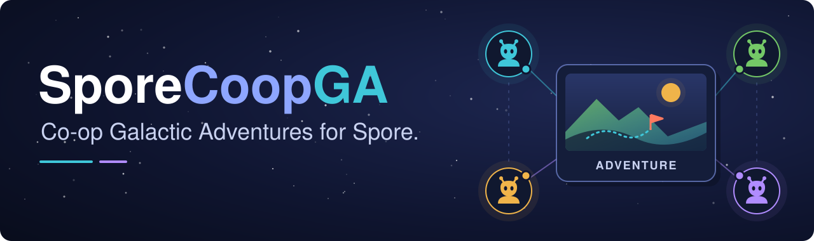

<p align="center">
  
</p>

<p align="center">
  <a href="https://github.com/jwhans0n/SporeCoopGA/actions/workflows/build.yml?query=branch%3Amain"></a>
  
  <a href="LICENSE"></a>
  
  <a href="https://discord.gg/7Yre7u4b8x"></a>
</p>

# SporeCoopGA

**Play Spore: Galactic Adventures together.** Form a party, choose your captains,
and enter the same adventure from Sporepedia.

This fork focuses on co-op adventure play, with **shared live adventure editing**
next on the roadmap and collaborative editing in other Spore editors later.
Shared editing is planned and is not available in the current release.

SporeCoopGA builds on [SporeCoop](https://github.com/WoodyWizard/SporeCoop) by
[WoodyWizard](https://github.com/WoodyWizard). The first published GA release is
**[`0.7.4.0`](https://github.com/jwhans0n/SporeCoopGA/releases/tag/v0.7.4.0)**,
using protocol **15**. Galactic Adventures support remains **experimental**.

## Contents

- [Current GA features](#current-ga-features)
- [Installation](#installation)
- [Playing together](#playing-together)
- [Compatibility and status](#compatibility-and-status)
- [Roadmap](#roadmap)
- [Inherited upstream compatibility and testing](#inherited-upstream-compatibility-and-testing)
- [Community](#community)
- [Development](#development)
- [Credits](#credits)

The separately installed shared Adventure Editor preview 9 (C49) uses protocol
23 and remains under validation. The current upstream-integration source is an
**uninstalled protocol 24 candidate**, with native acceptance pending. It does
not update that installed preview or the published protocol 15 gameplay release.
See the [editor preview 9 report](docs/reports/EDITOR-PREVIEW9-VALIDATION.md) and
[protocol scope](docs/04-netcode.md#netcode-protocol-scope) for the separate limits.

## Current GA features

- **Shared Sporepedia adventures.** Form a party of up to four players, then use
  an adventure's normal Play button. Supported missing adventure and captain
  resources transfer during preparation; stock resources and cached transfers are reused.
- **Your saved captain.** Select an existing captain or use the native creation,
  naming and saving screens. Adventures with an authored captain keep that restriction.
- **A shared adventure lobby.** Review the adventure card, captain portraits,
  transfer progress and settings. Everyone, including the host, explicitly presses Ready.
- **Shared objectives and scenes.** Host-authoritative progress keeps the party
  in the same act. Beam-down Continue waits for everyone; conversation pages
  advance independently, with a group confirmation before leaving. Confirmations
  appear in the native bottom black bar beside the check mark.
- **Synchronized interactions.** Shared keys and gates, explosives, crates,
  collector-only power upgrades and independent teleporters follow the adventure
  rules. The host controls authoritative damage and shared object state.
- **Shared handheld items.** Give items to NPCs through native interactions,
  see their held tools, and throw eligible items between captains. Timed bombs
  keep their running fuse when caught; contact grenades retain impact behavior.
- **Party pause.** Opening Esc stops your input; the shared adventure pauses
  when every connected participant is paused and resumes when anyone returns.
- **Native actor movement.** Client creatures and vehicles follow host waypoints
  between updates using native locomotion. Hard corrections handle initial
  binding, large divergence, stuck movement and confirmed stationary disagreement;
  the host retains AI, combat and objective authority.
- **Enemy targeting for guest captains.** Authored player-team attack targets
  can recognize eligible guests. Native sensing, hostility and NPC target
  selection remain in control; existing authored nonparty targets are preserved.
- **Downed and revival feedback.** Downed captains stay in place while their
  normal visuals update. A six-metre revive ring, progress bar and timer show
  teammates where to stand and how long to remain nearby.
- **Shared results and recovery.** A host-confirmed win or loss stops gameplay for
  the party. Host Done returns everyone to the menu; guest Done accepts results
  locally. Replay requires the host to choose Replay and everyone to apply and
  accept their results, then opens
  the shared lobby with saved captains and everyone unready. Cancelling preparation
  restores the native menus for retry.
- **Adventure performance work.** The release retains the actor-memory validation
  FPS fix. Unchanged static transforms stop recurring after their initial baseline;
  moving actors continue receiving spatial updates.

See the [GA guide](docs/GALACTIC-ADVENTURES.md) for interaction rules, settings,
asset transfer, Replay and current limits.

## Installation

Every player needs **Spore with Galactic Adventures**, the supported GOG executable
described below, and **the same SporeCoopGA build**.

Install the published release from this fork:

1. Open the [0.7.4.0 release](https://github.com/jwhans0n/SporeCoopGA/releases/tag/v0.7.4.0)
   and download **`SporeCoop-0.7.4.0.zip`**.
2. Extract the release zip. Keep **`SporeCoopSetup.exe`** beside its matching
   **`SporeCoop-0.7.4.0.pack`** file.
3. Close Spore, run that setup, select the **SPORE** folder containing
   `SporebinEP1`, and install.
4. Start Galactic Adventures (`SporebinEP1\SporeApp.exe`). The galaxy menu should
   contain **Co-op**.

The zip also includes `install.bat` for manual installation.
Full setup, game-build checks, networking and troubleshooting are in the
[installation guide](docs/INSTALL.md). Use this fork's packages for GA support.

**Updates use published [GitHub Releases](https://github.com/jwhans0n/SporeCoopGA/releases),
not branches or Actions artifacts.** Version 0.7.4.0 is published as a normal
release so the updater can discover it; its GA support is still experimental.
The updater skips prereleases and compares up to four numeric version components.
This release sorts above `0.7.3.5-ga-preview.12`. Merging new source into `main`
does not update an installed game.

## Playing together

1. From the galaxy menu, the host opens **Co-op** and hosts a party. Other players
   join before the adventure begins. **F9** opens party and chat controls.
2. The host chooses the difficulty in **Adventure settings**.
3. The host opens the adventure in **Sporepedia** and presses **Play**.
4. Each player selects a captain, or creates, names and saves a new one using the
   native captain screens.
5. Review the adventure and captain cards. Wait for preparation to finish, then
   **every player presses Ready**, including the host.
6. After beam-down, **everyone presses Continue**. Gameplay and adventure clocks
   wait for the whole party.

Changing a captain clears readiness. Cancelling preparation keeps successfully
saved captains and returns the party to the menu. After a win or loss, gameplay
stays stopped. **Host Done returns the whole party to the menu.** Guest Done
accepts that player's results locally. Any player can request Replay; the host
must choose Replay and everyone must apply and accept their results before the
shared lobby opens. Everyone presses Ready again. Finish any mandatory native
captain reward selection before a party exit completes, so captain saving is
preserved. The party stays connected through menu recovery.

For LAN discovery, internet connections and port forwarding, see
[networking in the installation guide](docs/INSTALL.md#7-playing-over-the-internet).

## Compatibility and status

Native co-op adventures currently require the **exact GOG 2024 executable**:
`SporebinEP1\SporeApp.exe`, 24,895,536 bytes, with SHA-256:

```text
dc04aee5a3debc3f1ad4c1a937460e99a29b9bd3bc285008be83615dd5e59a37
```

- **Verified GA configuration:** Windows with that exact executable. Steam and
  other executables are not enabled for the native GA adapter; Linux GA play
  remains unvalidated.
- **Matching clients:** all participants need this fork build and protocol 15.
  Update GA previews to this release before joining. Previews using protocol 14
  or older cannot join.
  Upstream SporeCoop 0.7.0-0.7.2.1 clients use a different protocol and cannot join.
- **Entry and joining:** adventures start from Sporepedia. Space-stage adventure
  entry is outside this release. Late joins and reconnects wait for the next attempt.
- **Validation scope:** the [0.7.4.0 release report](docs/validation-ga-0.7.4.0.md)
  records release packaging and checks. Preview 12's shared-result, menu return and
  Replay acceptance remains recorded in its
  [validation report](docs/validation-ga-preview.12.md). Earlier preview 11 passes
  targeted two-player Mine checks for
  native guest/host targeting, natural damage and target switching. Broader
  adventure compatibility remains unproven; see its
  [validation report](docs/validation-ga-preview.11.md) for exact evidence.
  Preview 10 repairs frozen vehicle models and verifies continuous
  native creature walking in two-player Mine checks. Position tracking remains
  approximate; its [validation report](docs/validation-ga-preview.10.md) records
  material residual lag and the exact scope. The [preview 9 report](docs/validation-ga-preview.9.md) retains its
  NPC presentation, unanimous pause and six-metre revival checks. The
  [preview 8 report](docs/validation-ga-preview.8.md) retains the earlier music,
  item, downed, lighting, conversation/Replay and four-player evidence.
  Ordinary guest click/key combat input remains unverified; controlled damage
  checks do not establish that input path.
  A complete adventure playthrough campaign remains outstanding.

The release does not establish compatibility with every custom adventure, palette
or objective. Read the [release validation report](docs/validation-ga-0.7.4.0.md),
[preview 12 validation report](docs/validation-ga-preview.12.md)
and [historical integration report](docs/integration-ga-upstream-0.7.2.1.md)
for exact evidence and limits, and the [known issues](docs/known-issues.md) for
recorded problems.

## Roadmap

1. **Strengthen co-op adventure play (ongoing).** Broader adventure compatibility,
   complete playthrough coverage, and extended multiplayer testing.
2. **Shared live Adventure Editor (in development).** Multiple players create and
   edit the same adventure together in real time. Placement integration is under
   validation; it is separate from the published gameplay release.
3. **Additional Spore editors (later, planned).** Extend collaborative editing
   after the Adventure Editor.

These are goals without announced dates. Shared adventure editing and other
collaborative editors are not implemented in the current release.

The [multiplayer Adventure Editor implementation plan](docs/MULTIPLAYER-ADVENTURE-EDITOR-PLAN.md)
records the initial preview decisions and validation gates. The first planned
preview includes shared placement/property editing, conservative per-player Undo,
saving, recovery and whole-party playtests. Follow-up work covers shared activity
history and selective Undo/reapplication, independent act editing when additional
native work is required, and playtesting while other participants continue editing.
The [editor development guide](docs/MULTIPLAYER-ADVENTURE-EDITOR.md) documents
preview 4 placement fixes, native cast properties/imports, solo Play and Test
Together, along with their remaining acceptance gates. Objectives, independent
act authoring and the later editing milestones remain planned.

## Inherited upstream compatibility and testing

The following is upstream's base-stage evidence and usage guidance, retained
from 0.7.3.6. It does not enable the fork's exact-file GA adapter on Steam or
establish Linux GA support. Protocol 7 compatibility statements apply only to
the upstream release line; the fork's protocols 15, 23 and 24 require matching
clients as described above. The upstream setup and release links below are for
the original project, not packages for this fork's GA support.

| Game version | `SporeApp.exe` | Windows 11 | Linux (Wine / Proton) |
|---|---|---|---|
| **GOG**, the current download (2024 update) | 24 895 536 bytes, `dc04aee5…` | ✅ 0.6.1: every stage as host + guest; 0.7.1, 0.7.2: with a Steam player | ✅ 0.7.0: the full automated suite (every stage, every Space feature) |
| **Steam**, Spore + Galactic Adventures (October 2024 update) | 25 066 744 bytes, `3010a413…` | ✅ 0.7.1, 0.7.2: Steam guest + GOG host (Creature), Steam offline ¹ | ✅ 0.7.1: Steam + Proton, offline |
| **GOG 2016**, the older GOG download | 24 888 320 bytes, `922af7c7…` | ❔ not tested | ✅ up to 0.7.0: SporeCoop was developed on it; the fixes since 0.7.2.2 that need new game addresses are off ² |
| EA app / Origin, disc | other files | ❌ not supported yet | ❌ not supported yet |

¹ With Steam **online** its overlay can keep the game's frames from the mod (no *Co-op* item,
[issue #4](https://github.com/WoodyWizard/SporeCoop/issues/4)). Since 0.7.2 the mod then takes its
frames from the game loop; tested by simulating that case, not yet with the real overlay.
² 0.7.x is the last version for the GOG 2016 build; from 0.8 only the current GOG build (and Steam,
which is the same game): update the game through GOG. Since 0.7.2.2 new fixes get game addresses for
the current build only: on GOG 2016 they switch themselves off (Alt+Shift+Enter, the hatchling growing
up after a death, the pack, Cell bites, meat and spin, NPC nations' vehicles on a guest's game, our
creatures kept out of saves); the other fixes work there too. The full list, checked by the build:
[data/symbols/frozen_off_922af7c7.txt](data/symbols/frozen_off_922af7c7.txt).

**Playing together:** GOG 2024 and Steam players can play together (the same game code). A GOG
2016 player cannot join a GOG 2024 or Steam host (the host turns away another build). Every player
needs the same SporeCoop protocol: within upstream's protocol 7 release line,
every 0.7 version plays with every other, while 0.6.x cannot join 0.7. This does
not include this fork's differently versioned GA or editor protocols.
With an older 0.7 version (0.7.2.x, 0.7.3.0) on one side, chat lines above about 1160 bytes arrive
cut and the Creature species table of a planet with 42 or more species does not reach that player;
the game names that player in a notification. Update everybody to the latest version.

**Not tested yet:** two PCs over the internet with Windows on 0.7 (the network code is the same
as on Linux, where it was tested), the EA app and disc versions. Which build you have:
`SporeCoopSetup.exe` shows it, or see [INSTALL.md, section 2](docs/INSTALL.md#2-check-your-game-build).
Tried another version? Please tell us in an [issue](https://github.com/WoodyWizard/SporeCoop/issues)
with `mods\logs\sporekit.log`.

## How to play

**Host**

1. Galaxy menu → **Co-op** → type your name → **Host**.
2. Load a save or start a new game. The window shows the addresses your friends can use.

**Guest**

1. Galaxy menu → **Co-op** → type your name.
2. Click the host under *Games on your network*, or type the host's address (e.g. `100.64.12.7` on
   Tailscale) → **Join**.
3. The host's world arrives and loads by itself; you appear next to the host with your own creature.

**In game**

| Key / command | What it does |
|---|---|
| **F9** | the co-op window: players, stage, ping, readiness, chat, *Send my world*, *Leave* |
| *I'm ready* | agree to evolve (editor, next stage) |
| `Ctrl+Shift+C` → `coop status` | session details in the cheat console |
| `coop say <text>` | chat |
| `coop ping` | show everybody the place under your mouse (Tribe, Civilization) |
| `coop give` | give your selected tribe members, vehicles or the opened city to a partner |
| `coop role 1`…`3` | Civilization role: military, economic, religious |

**Example: two friends over the internet**

```
Alice (GOG) and Bob (Steam) install Tailscale and the same SporeCoop version.
Alice: Co-op → "Alice" → Host → loads her Tribe save.
       The window says: friends connect to 100.64.12.7:47810
Bob:   Co-op → "Bob" → 100.64.12.7 → Join.
       Alice's tribe loads; Bob gets his share of the members and his own chief.
Both:  F9 → I'm ready when the tribe is ready for Civilization.
```

For inherited Steam setup, Galactic Adventures is app 24720 in
`steamapps\common\Spore 24720`; base Spore's `steamapps\common\Spore`
has no `SporebinEP1`. If the setup cannot find the GA folder, select it directly.
Run upstream setup inside the game's Wine prefix on Linux. A "GitHub not
reachable" setup error can use the matching release zip's `install.bat`; see
[troubleshooting](docs/INSTALL.md#9-troubleshooting). Fork GA installation still
uses this fork's matching packages and verified executable.

Upstream version 0.7 (its newest release is on the [Releases](https://github.com/WoodyWizard/SporeCoop/releases/latest) page): co-op in every stage for up to 4 players, and a Space stage built for playing
together (the F9 window's **Space** page: partners on the map, allied colonies, trade, contracts,
shared diplomacy, the galactic core together, rivals mode). Tested automatically on real game
instances: 50+ scenario tests with real clicks, bots that play every stage through real input for
hours, 4-player sessions with rejoins, a chaos bot and simulated bad networks
([stability report](docs/stability-report.md)).
Known issues: [docs/known-issues.md](docs/known-issues.md). Found a problem? Type `/bug <what you
see>` in the co-op chat when it happens (it marks that moment in every player's log), then see
[how to report it](docs/REPORTING.md).

Upstream's remaining roadmap at that checkpoint:

- [ ] easier internet play (no VPN or port forwarding)
- [ ] tests with the EA app build, and of the Steam build with Steam online (overlay)
- [ ] four-player tests of the 0.7 Space features, co-op adventures
- [ ] **Rivals mode**: every player with a base, a species, a tribe, a nation and an empire of its
  own in the same world, a race through every stage with war, peace and alliances
  ([design](docs/11-rivals.md))

## Community

Join the **[SporeCoop Discord](https://discord.gg/7Yre7u4b8x)**: find players to evolve with, ask for help with the setup,
share your worlds and creatures, report problems and suggest ideas. Report this
fork's GA/editor problems in a [fork issue](https://github.com/jwhans0n/SporeCoopGA/issues).
Original upstream reports use its [issue templates](https://github.com/WoodyWizard/SporeCoop/issues/new/choose).
The [reporting guide](docs/REPORTING.md) explains the diagnostic files and `/bug` marker.

## Development

SporeCoopGA inherits SporeCoop's multiplayer core, SporeKit runtime and Cell-to-Space
systems. See the [original project](https://github.com/WoodyWizard/SporeCoop) for
its base-stage feature overview. The fork's focus and validation are GA-specific;
inherited upstream compatibility and test history are separate from GA results.

The project builds 32-bit Windows binaries on Linux with
[llvm-mingw](https://github.com/mstorsjo/llvm-mingw).

```bash
git clone https://github.com/jwhans0n/SporeCoopGA.git
cd SporeCoopGA
make LLVM_MINGW=/path/to/llvm-mingw
make test
tools/package.sh
```

Start with the [documentation index](docs/README.md),
[architecture](docs/01-architecture.md), [netcode](docs/04-netcode.md),
[testing guide](docs/06-testing.md), and [reverse-engineering notes](docs/re/).
Use isolated test profiles for development.

## Credits

- Original SporeCoop and SporeKit by [WoodyWizard](https://github.com/WoodyWizard).
  [Support the original SporeCoop author](https://buymeacoffee.com/chamomilewoods).
- Galactic Adventures fork maintained by [jwhans0n](https://github.com/jwhans0n).
- Game function names and addresses draw on
  [Spore ModAPI](https://github.com/Spore-Community/Spore-ModAPI) and the Spore
  modding community. Hooks use [MinHook](https://github.com/TsudaKageyu/minhook).
  See [third-party notices](THIRD_PARTY_NOTICES.md) for details.
- Spore is a trademark of Electronic Arts Inc. This is an unofficial fan mod,
  unaffiliated with Electronic Arts or Maxis. It contains no game files.

Licensed under the [MIT license](LICENSE).
